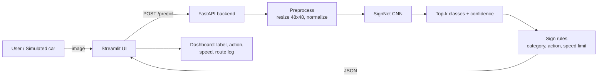
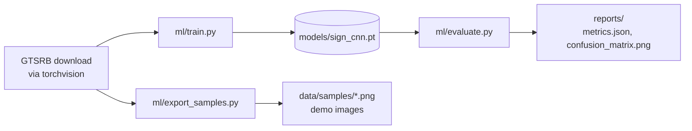

# SignSense — Traffic Sign Recognition MVP Walkthrough

An end-to-end build guide for **P4: Traffic Sign Recognition for Autonomous Vehicles**. By the end you will have:

1. A **PyTorch CNN** trained on the German Traffic Sign Recognition Benchmark (GTSRB, 43 classes, ~50k images), at roughly 97–99% test accuracy.
2. A **FastAPI backend** that serves predictions, confidence scores, and a "what should the car do" action for each sign.
3. A **Streamlit frontend** with four views: single-image classification (upload, test sample, or webcam), batch classification, a **self-driving simulation** where a virtual car reacts to a stream of signs, and a model report page.

Everything is Python.

---

## 0. MVP scope

| In scope (MVP) | Out of scope (see section 12) |
| --- | --- |
| Classifying a cropped sign image into 1 of 43 classes | Finding signs inside a full dashcam frame (detection) |
| Confidence threshold and an "uncertain" flag | Video streams and tracking signs across frames |
| A rule-based planner that turns signs into speed commands | Real vehicle control and simulators such as CARLA |
| REST API, web UI, tests | Auth, deployment, monitoring |

A real autonomous-vehicle pipeline has two stages: a **detector** that finds where the signs are in the frame, then a **classifier** that decides which sign each one is. This MVP builds the classifier, which is the core deep-learning part, and simulates the "car" around it. Adding a detector later doesn't change anything you build here.

### Demo flow



### Offline training flow



---

## 1. Tech stack

| Layer | Choice | Why |
| --- | --- | --- |
| Deep learning | PyTorch + torchvision | `torchvision.datasets.GTSRB` downloads and parses the dataset for you |
| Backend | FastAPI + Uvicorn | Async, typed request/response models, free Swagger docs at `/docs` |
| Frontend | Streamlit | Interactive UI in pure Python, with built-in file upload and camera input |
| Metrics | scikit-learn, matplotlib | Classification report and confusion matrix |
| Tests | pytest + FastAPI `TestClient` | API tests that don't need the trained model |

Python 3.11–3.13 all work.

---

## 2. Project structure

```
sign_sense/
├── walkthrough.md
├── requirements.txt
├── pyproject.toml            # pytest config only
├── .gitignore
├── ml/
│   ├── __init__.py
│   ├── config.py             # paths, image size, class names
│   ├── signs.py              # class -> category / driving action
│   ├── utils.py              # device selection
│   ├── data.py               # datasets, transforms, dataloaders
│   ├── model.py              # SignNet CNN
│   ├── train.py              # training loop -> models/sign_cnn.pt
│   ├── evaluate.py           # test metrics -> reports/
│   └── export_samples.py     # demo images -> data/samples/
├── backend/
│   ├── __init__.py
│   ├── schemas.py            # Pydantic response models
│   ├── inference.py          # SignClassifier (load model, predict)
│   └── main.py               # FastAPI app
├── frontend/
│   └── app.py                # Streamlit UI
├── tests/
│   └── test_api.py
├── data/                     # created automatically (gitignored)
├── models/                   # trained checkpoint
└── reports/                  # metrics and plots
```

`ml/__init__.py` and `backend/__init__.py` are empty files. They make the folders importable as packages, which is why every command below runs **from the project root** (`python -m ml.train`, `uvicorn backend.main:app`).

---

## 3. Phase 0 — Environment setup

```bash
cd ~/Desktop/sign_sense
python3 -m venv .venv
source .venv/bin/activate
mkdir -p ml backend frontend tests
touch ml/__init__.py backend/__init__.py
```

**`requirements.txt`**

```text
torch>=2.5
torchvision>=0.20
numpy>=1.26
pillow>=10.4
pandas>=2.2
scikit-learn>=1.5
matplotlib>=3.9
tqdm>=4.66
fastapi>=0.115
uvicorn[standard]>=0.30
python-multipart>=0.0.9
streamlit>=1.40
requests>=2.32
pytest>=8.0
httpx>=0.27
```

```bash
pip install --upgrade pip
pip install -r requirements.txt
python -c "import torch; print(torch.__version__, 'MPS:', torch.backends.mps.is_available())"
```

On an Apple Silicon Mac, `MPS: True` means training will use the GPU.

**`pyproject.toml`** (lets pytest import `ml` and `backend` from the root)

```toml
[tool.pytest.ini_options]
pythonpath = ["."]
testpaths = ["tests"]
```

**`.gitignore`**

```text
.venv/
__pycache__/
data/
.pytest_cache/
.DS_Store
```

---

## 4. Phase 1 — Data

### About GTSRB

- 43 classes: speed limits, prohibitions, warnings, mandatory directions, stop, yield, and more.
- About 39k training images and 12.6k test images. Images range from 15×15 to 250×250 pixels.
- The classes are **imbalanced**. "Speed limit 50" has about 2,000 training images, while "Speed limit 20" has about 200.
- The training set is made of **tracks**: about 30 consecutive frames of the same physical sign. A random train/validation split therefore puts near-duplicate images on both sides, so validation accuracy comes out optimistic. **Report the test-set number** as your real result.

### `ml/config.py`

```python
from pathlib import Path

ROOT = Path(__file__).resolve().parent.parent
DATA_DIR = ROOT / "data"
SAMPLES_DIR = DATA_DIR / "samples"
MODELS_DIR = ROOT / "models"
REPORTS_DIR = ROOT / "reports"
CHECKPOINT_PATH = MODELS_DIR / "sign_cnn.pt"

IMG_SIZE = 48
NUM_CLASSES = 43

# Per-channel statistics of the GTSRB training set.
MEAN = (0.3403, 0.3121, 0.3214)
STD = (0.2724, 0.2608, 0.2669)

CLASS_NAMES = [
    "Speed limit (20km/h)",
    "Speed limit (30km/h)",
    "Speed limit (50km/h)",
    "Speed limit (60km/h)",
    "Speed limit (70km/h)",
    "Speed limit (80km/h)",
    "End of speed limit (80km/h)",
    "Speed limit (100km/h)",
    "Speed limit (120km/h)",
    "No passing",
    "No passing for vehicles over 3.5 t",
    "Right-of-way at the next intersection",
    "Priority road",
    "Yield",
    "Stop",
    "No vehicles",
    "Vehicles over 3.5 t prohibited",
    "No entry",
    "General caution",
    "Dangerous curve to the left",
    "Dangerous curve to the right",
    "Double curve",
    "Bumpy road",
    "Slippery road",
    "Road narrows on the right",
    "Road work",
    "Traffic signals",
    "Pedestrians",
    "Children crossing",
    "Bicycles crossing",
    "Beware of ice/snow",
    "Wild animals crossing",
    "End of all speed and passing limits",
    "Turn right ahead",
    "Turn left ahead",
    "Ahead only",
    "Go straight or right",
    "Go straight or left",
    "Keep right",
    "Keep left",
    "Roundabout mandatory",
    "End of no passing",
    "End of no passing for vehicles over 3.5 t",
]
```

### `ml/signs.py` — turning a class into a driving decision

This is the "autonomous vehicle" layer: it maps each sign to a category and an action. The backend returns this with every prediction.

```python
from ml.config import CLASS_NAMES

SPEED_LIMITS = {0: 20, 1: 30, 2: 50, 3: 60, 4: 70, 5: 80, 7: 100, 8: 120}
END_OF_RESTRICTION = {6, 32, 41, 42}
NO_ENTRY = {15, 17}
PROHIBITORY = {9, 10, 16}
PRIORITY = {11, 12}
WARNING = set(range(18, 32))
MANDATORY = set(range(33, 41))
YIELD, STOP = 13, 14


def _info(category: str, action: str, speed_limit_kmh: int | None = None) -> dict:
    return {"category": category, "action": action, "speed_limit_kmh": speed_limit_kmh}


def describe(class_id: int) -> dict:
    name = CLASS_NAMES[class_id]
    if class_id in SPEED_LIMITS:
        limit = SPEED_LIMITS[class_id]
        return _info("speed_limit", f"Set target speed to {limit} km/h", limit)
    if class_id == STOP:
        return _info("stop", "Come to a full stop at the line, proceed when clear")
    if class_id == YIELD:
        return _info("yield", "Slow down and give way to crossing traffic")
    if class_id in PRIORITY:
        return _info("priority", "Maintain speed, you have right of way")
    if class_id in NO_ENTRY:
        return _info("no_entry", "Do not enter, plan an alternative route")
    if class_id in PROHIBITORY:
        return _info("prohibitory", f"Restriction active: {name}")
    if class_id in END_OF_RESTRICTION:
        return _info("end_of_restriction", f"{name}: restore default behaviour")
    if class_id in WARNING:
        return _info("warning", f"Hazard ahead ({name}), reduce speed")
    if class_id in MANDATORY:
        return _info("mandatory", f"Follow mandatory direction: {name}")
    return _info("other", name)
```

### `ml/utils.py`

```python
import os

import torch


def get_device() -> torch.device:
    if override := os.getenv("DEVICE"):
        return torch.device(override)
    if torch.cuda.is_available():
        return torch.device("cuda")
    if torch.backends.mps.is_available():
        return torch.device("mps")
    return torch.device("cpu")
```

### `ml/data.py`

One detail matters a lot here: **don't use horizontal flips** for augmentation. Flipping "Turn left ahead" turns it into "Turn right ahead" while the label still says left, which corrupts the training data. Small rotations, shifts, and lighting changes are safe.

```python
import torch
from torch.utils.data import DataLoader, Subset
from torchvision import datasets, transforms

from ml.config import DATA_DIR, IMG_SIZE, MEAN, STD


def build_transform(train: bool) -> transforms.Compose:
    steps = [transforms.Resize((IMG_SIZE, IMG_SIZE))]
    if train:
        steps += [
            transforms.RandomAffine(degrees=10, translate=(0.1, 0.1), scale=(0.9, 1.1), shear=5),
            transforms.ColorJitter(brightness=0.4, contrast=0.4, saturation=0.3),
        ]
    steps += [transforms.ToTensor(), transforms.Normalize(MEAN, STD)]
    return transforms.Compose(steps)


def _loader(dataset, batch_size: int, shuffle: bool, num_workers: int) -> DataLoader:
    return DataLoader(
        dataset,
        batch_size=batch_size,
        shuffle=shuffle,
        num_workers=num_workers,
        persistent_workers=num_workers > 0,
        pin_memory=torch.cuda.is_available(),
    )


def get_dataloaders(batch_size: int = 128, val_fraction: float = 0.1,
                    num_workers: int = 2, seed: int = 42) -> tuple[DataLoader, DataLoader]:
    # Two views of the same training set so validation images are not augmented.
    train_view = datasets.GTSRB(DATA_DIR, split="train", transform=build_transform(True), download=True)
    val_view = datasets.GTSRB(DATA_DIR, split="train", transform=build_transform(False), download=True)

    generator = torch.Generator().manual_seed(seed)
    indices = torch.randperm(len(train_view), generator=generator).tolist()
    n_val = int(len(indices) * val_fraction)

    train_ds = Subset(train_view, indices[n_val:])
    val_ds = Subset(val_view, indices[:n_val])
    return (
        _loader(train_ds, batch_size, True, num_workers),
        _loader(val_ds, batch_size, False, num_workers),
    )


def get_test_loader(batch_size: int = 256, num_workers: int = 2) -> DataLoader:
    test_ds = datasets.GTSRB(DATA_DIR, split="test", transform=build_transform(False), download=True)
    return _loader(test_ds, batch_size, False, num_workers)
```

The first run downloads about 350 MB into `data/gtsrb/`. Later runs reuse it.

---

## 5. Phase 2 — Model and training

### `ml/model.py` — SignNet

A compact VGG-style CNN with three blocks (48 → 24 → 12 → 6 pixels), batch normalization, and dropout. It has about 1.5M parameters, trains in minutes, and matches the accuracy of much bigger pretrained models on GTSRB.

```python
from torch import nn


def conv_block(in_ch: int, out_ch: int, dropout: float) -> nn.Sequential:
    return nn.Sequential(
        nn.Conv2d(in_ch, out_ch, kernel_size=3, padding=1, bias=False),
        nn.BatchNorm2d(out_ch),
        nn.ReLU(inplace=True),
        nn.Conv2d(out_ch, out_ch, kernel_size=3, padding=1, bias=False),
        nn.BatchNorm2d(out_ch),
        nn.ReLU(inplace=True),
        nn.MaxPool2d(2),
        nn.Dropout(dropout),
    )


class SignNet(nn.Module):
    def __init__(self, num_classes: int = 43, img_size: int = 48):
        super().__init__()
        self.features = nn.Sequential(
            conv_block(3, 32, 0.1),
            conv_block(32, 64, 0.2),
            conv_block(64, 128, 0.3),
        )
        feature_size = img_size // 8
        self.classifier = nn.Sequential(
            nn.Flatten(),
            nn.Linear(128 * feature_size * feature_size, 256),
            nn.ReLU(inplace=True),
            nn.Dropout(0.5),
            nn.Linear(256, num_classes),
        )

    def forward(self, x):
        return self.classifier(self.features(x))
```

### `ml/train.py`

```python
import argparse
import json

import matplotlib

matplotlib.use("Agg")
import matplotlib.pyplot as plt
import torch
from torch import nn
from tqdm import tqdm

from ml.config import (CHECKPOINT_PATH, CLASS_NAMES, IMG_SIZE, MEAN, MODELS_DIR,
                       NUM_CLASSES, REPORTS_DIR, STD)
from ml.data import get_dataloaders
from ml.model import SignNet
from ml.utils import get_device


def run_epoch(model, loader, criterion, device, optimizer=None) -> tuple[float, float]:
    training = optimizer is not None
    model.train(training)
    total_loss, correct, seen = 0.0, 0, 0
    with torch.set_grad_enabled(training):
        for images, labels in tqdm(loader, leave=False, desc="train" if training else "val"):
            images, labels = images.to(device), labels.to(device)
            logits = model(images)
            loss = criterion(logits, labels)
            if training:
                optimizer.zero_grad(set_to_none=True)
                loss.backward()
                optimizer.step()
            total_loss += loss.item() * labels.size(0)
            correct += (logits.argmax(dim=1) == labels).sum().item()
            seen += labels.size(0)
    return total_loss / seen, correct / seen


def plot_history(history: dict, path) -> None:
    epochs = range(1, len(history["train_loss"]) + 1)
    fig, (ax_loss, ax_acc) = plt.subplots(1, 2, figsize=(12, 4))
    ax_loss.plot(epochs, history["train_loss"], label="train")
    ax_loss.plot(epochs, history["val_loss"], label="val")
    ax_loss.set_title("Loss")
    ax_loss.set_xlabel("epoch")
    ax_loss.legend()
    ax_acc.plot(epochs, history["train_acc"], label="train")
    ax_acc.plot(epochs, history["val_acc"], label="val")
    ax_acc.set_title("Accuracy")
    ax_acc.set_xlabel("epoch")
    ax_acc.legend()
    fig.tight_layout()
    fig.savefig(path, dpi=120)
    plt.close(fig)


def main() -> None:
    parser = argparse.ArgumentParser(description="Train SignNet on GTSRB")
    parser.add_argument("--epochs", type=int, default=15)
    parser.add_argument("--batch-size", type=int, default=128)
    parser.add_argument("--lr", type=float, default=1e-3)
    parser.add_argument("--num-workers", type=int, default=2)
    args = parser.parse_args()

    torch.manual_seed(42)
    MODELS_DIR.mkdir(parents=True, exist_ok=True)
    REPORTS_DIR.mkdir(parents=True, exist_ok=True)

    device = get_device()
    print(f"Training on {device}")
    train_loader, val_loader = get_dataloaders(args.batch_size, num_workers=args.num_workers)

    model = SignNet(NUM_CLASSES, IMG_SIZE).to(device)
    criterion = nn.CrossEntropyLoss()
    optimizer = torch.optim.AdamW(model.parameters(), lr=args.lr, weight_decay=1e-4)
    scheduler = torch.optim.lr_scheduler.CosineAnnealingLR(optimizer, T_max=args.epochs)

    history = {"train_loss": [], "train_acc": [], "val_loss": [], "val_acc": []}
    best_acc = 0.0
    for epoch in range(1, args.epochs + 1):
        train_loss, train_acc = run_epoch(model, train_loader, criterion, device, optimizer)
        val_loss, val_acc = run_epoch(model, val_loader, criterion, device)
        scheduler.step()

        history["train_loss"].append(train_loss)
        history["train_acc"].append(train_acc)
        history["val_loss"].append(val_loss)
        history["val_acc"].append(val_acc)
        print(f"epoch {epoch:02d} | train loss {train_loss:.4f} acc {train_acc:.4f} "
              f"| val loss {val_loss:.4f} acc {val_acc:.4f}")

        if val_acc > best_acc:
            best_acc = val_acc
            torch.save(
                {
                    "state_dict": {k: v.cpu() for k, v in model.state_dict().items()},
                    "class_names": CLASS_NAMES,
                    "img_size": IMG_SIZE,
                    "mean": MEAN,
                    "std": STD,
                    "val_acc": val_acc,
                    "epoch": epoch,
                },
                CHECKPOINT_PATH,
            )
            print(f"  saved new best model (val acc {val_acc:.4f})")

    (REPORTS_DIR / "history.json").write_text(json.dumps(history, indent=2))
    plot_history(history, REPORTS_DIR / "training_curves.png")
    print(f"Best val accuracy {best_acc:.4f}, checkpoint at {CHECKPOINT_PATH}")


if __name__ == "__main__":
    main()
```

The checkpoint stores the class names, image size, and normalization stats alongside the weights. That way the backend never has to guess how the model was trained.

### Run training

```bash
python -m ml.train --epochs 15
# quick smoke test first if you like:
python -m ml.train --epochs 1
```

Expect validation accuracy above 99% after a few epochs (it's inflated by the track leakage described in Phase 1). Depending on your hardware, a full run takes somewhere between a few minutes and about 20 minutes.

---

## 6. Phase 3 — Evaluation and demo samples

### `ml/evaluate.py`

```python
import json

import matplotlib

matplotlib.use("Agg")
import matplotlib.pyplot as plt
import torch
from sklearn.metrics import accuracy_score, classification_report, confusion_matrix
from tqdm import tqdm

from ml.config import CHECKPOINT_PATH, CLASS_NAMES, NUM_CLASSES, REPORTS_DIR
from ml.data import get_test_loader
from ml.model import SignNet
from ml.utils import get_device


@torch.inference_mode()
def collect_predictions(model, loader, device):
    preds, targets = [], []
    for images, labels in tqdm(loader, desc="test"):
        preds.append(model(images.to(device)).argmax(dim=1).cpu())
        targets.append(labels)
    return torch.cat(targets).numpy(), torch.cat(preds).numpy()


def plot_confusion(y_true, y_pred, path) -> None:
    cm = confusion_matrix(y_true, y_pred, labels=list(range(NUM_CLASSES)), normalize="true")
    fig, ax = plt.subplots(figsize=(14, 12))
    image = ax.imshow(cm, cmap="Blues", vmin=0, vmax=1)
    ax.set_xticks(range(NUM_CLASSES))
    ax.set_yticks(range(NUM_CLASSES))
    ax.tick_params(labelsize=7)
    ax.set_xlabel("Predicted class id")
    ax.set_ylabel("True class id")
    ax.set_title("Normalized confusion matrix (GTSRB test set)")
    fig.colorbar(image)
    fig.tight_layout()
    fig.savefig(path, dpi=120)
    plt.close(fig)


def main() -> None:
    REPORTS_DIR.mkdir(parents=True, exist_ok=True)
    device = get_device()
    checkpoint = torch.load(CHECKPOINT_PATH, map_location=device, weights_only=True)
    model = SignNet(NUM_CLASSES, checkpoint["img_size"])
    model.load_state_dict(checkpoint["state_dict"])
    model.to(device).eval()

    y_true, y_pred = collect_predictions(model, get_test_loader(), device)
    report = classification_report(
        y_true, y_pred, labels=list(range(NUM_CLASSES)),
        target_names=CLASS_NAMES, output_dict=True, zero_division=0,
    )
    per_class_f1 = {name: float(report[name]["f1-score"]) for name in CLASS_NAMES}
    worst = sorted(per_class_f1.items(), key=lambda item: item[1])[:5]

    metrics = {
        "test_accuracy": float(accuracy_score(y_true, y_pred)),
        "macro_f1": float(report["macro avg"]["f1-score"]),
        "num_test_images": int(len(y_true)),
        "worst_classes": [{"class": name, "f1": f1} for name, f1 in worst],
        "per_class_f1": per_class_f1,
    }
    (REPORTS_DIR / "metrics.json").write_text(json.dumps(metrics, indent=2))
    plot_confusion(y_true, y_pred, REPORTS_DIR / "confusion_matrix.png")

    print(f"Test accuracy: {metrics['test_accuracy']:.4f}  Macro F1: {metrics['macro_f1']:.4f}")
    for row in metrics["worst_classes"]:
        print(f"  weakest: {row['class']:<45} F1 {row['f1']:.3f}")


if __name__ == "__main__":
    main()
```

### `ml/export_samples.py`

This saves real test-set images that the model has never seen, with the true class in the filename (for example `007_class14.png`). The UI uses them for the sample picker and the drive simulation, and reads the filename to show whether each prediction was correct.

```python
import argparse
import random

from torchvision import datasets

from ml.config import DATA_DIR, SAMPLES_DIR


def main() -> None:
    parser = argparse.ArgumentParser(description="Export GTSRB test images for the demo")
    parser.add_argument("--n", type=int, default=86)
    parser.add_argument("--seed", type=int, default=7)
    args = parser.parse_args()

    test_ds = datasets.GTSRB(DATA_DIR, split="test", download=True)
    SAMPLES_DIR.mkdir(parents=True, exist_ok=True)
    for old in SAMPLES_DIR.glob("*.png"):
        old.unlink()

    indices = random.Random(args.seed).sample(range(len(test_ds)), args.n)
    for i, idx in enumerate(indices):
        image, label = test_ds[idx]
        image.save(SAMPLES_DIR / f"{i:03d}_class{label:02d}.png")
    print(f"Saved {args.n} samples to {SAMPLES_DIR}")


if __name__ == "__main__":
    main()
```

```bash
python -m ml.evaluate
python -m ml.export_samples
```

A typical result for this model is **97–99% test accuracy**. Look at `reports/confusion_matrix.png`: the errors usually cluster among similar-looking speed limits (30/50/80), which is a good point to raise in a presentation.

---

## 7. Phase 4 — FastAPI backend

### API contract

| Method | Path | Purpose |
| --- | --- | --- |
| GET | `/health` | Liveness check, plus which device the model runs on |
| GET | `/classes` | All 43 classes with their categories |
| GET | `/model/info` | Architecture, parameter count, and validation/test metrics |
| POST | `/predict?top_k=5` | One image (multipart field `file`) in, one `Prediction` out |
| POST | `/predict/batch?top_k=3` | Up to 32 images (field `files`) in, a list of predictions out |

Example `Prediction`:

```json
{
  "filename": "007_class14.png",
  "class_id": 14,
  "label": "Stop",
  "confidence": 0.9987,
  "is_confident": true,
  "category": "stop",
  "action": "Come to a full stop at the line, proceed when clear",
  "speed_limit_kmh": null,
  "top_k": [{"class_id": 14, "label": "Stop", "confidence": 0.9987}, "..."],
  "inference_ms": 3.41
}
```

### `backend/schemas.py`

```python
from pydantic import BaseModel


class TopKItem(BaseModel):
    class_id: int
    label: str
    confidence: float


class Prediction(BaseModel):
    filename: str | None
    class_id: int
    label: str
    confidence: float
    is_confident: bool
    category: str
    action: str
    speed_limit_kmh: int | None
    top_k: list[TopKItem]
    inference_ms: float


class BatchPrediction(BaseModel):
    predictions: list[Prediction]
    total_ms: float


class HealthResponse(BaseModel):
    status: str
    model_loaded: bool
    device: str


class ClassInfo(BaseModel):
    class_id: int
    label: str
    category: str


class ModelInfo(BaseModel):
    architecture: str
    num_classes: int
    num_parameters: int
    img_size: int
    device: str
    val_accuracy: float | None
    test_metrics: dict | None
```

### `backend/inference.py`

```python
import io
from pathlib import Path

import torch
from PIL import Image
from torchvision import transforms

from ml.model import SignNet
from ml.utils import get_device


class SignClassifier:
    def __init__(self, checkpoint_path: Path):
        self.device = get_device()
        checkpoint = torch.load(checkpoint_path, map_location="cpu", weights_only=True)
        self.class_names: list[str] = list(checkpoint["class_names"])
        self.img_size: int = checkpoint["img_size"]
        self.val_acc: float | None = checkpoint.get("val_acc")

        self.model = SignNet(len(self.class_names), self.img_size)
        self.model.load_state_dict(checkpoint["state_dict"])
        self.model.to(self.device).eval()
        self.num_parameters = sum(p.numel() for p in self.model.parameters())

        self.transform = transforms.Compose([
            transforms.Resize((self.img_size, self.img_size)),
            transforms.ToTensor(),
            transforms.Normalize(checkpoint["mean"], checkpoint["std"]),
        ])
        self.predict([Image.new("RGB", (self.img_size, self.img_size))])  # warm-up

    @staticmethod
    def load_image(data: bytes) -> Image.Image:
        return Image.open(io.BytesIO(data)).convert("RGB")

    @torch.inference_mode()
    def predict(self, images: list[Image.Image], top_k: int = 5) -> list[list[tuple[int, float]]]:
        batch = torch.stack([self.transform(image) for image in images]).to(self.device)
        probabilities = torch.softmax(self.model(batch), dim=1)
        confidences, indices = probabilities.topk(min(top_k, len(self.class_names)), dim=1)
        return [
            list(zip(idx.tolist(), conf.tolist()))
            for idx, conf in zip(indices.cpu(), confidences.cpu())
        ]
```

**Train/serve consistency** is the most common source of bugs in ML APIs: if serving preprocesses images differently from training, accuracy silently drops. Here the serving transform is built from the values saved in the checkpoint, so it always matches the evaluation transform from training.

### `backend/main.py`

```python
import json
import os
import time
from contextlib import asynccontextmanager
from pathlib import Path

from fastapi import FastAPI, File, HTTPException, Query, UploadFile
from fastapi.concurrency import run_in_threadpool
from fastapi.middleware.cors import CORSMiddleware
from PIL import Image

from backend.inference import SignClassifier
from backend.schemas import (BatchPrediction, ClassInfo, HealthResponse, ModelInfo,
                             Prediction, TopKItem)
from ml.config import CHECKPOINT_PATH, REPORTS_DIR
from ml.signs import describe

CONFIDENCE_THRESHOLD = float(os.getenv("CONFIDENCE_THRESHOLD", "0.6"))
MAX_FILE_BYTES = 5 * 1024 * 1024
MAX_BATCH = 32

state: dict[str, SignClassifier] = {}


@asynccontextmanager
async def lifespan(app: FastAPI):
    checkpoint = Path(os.getenv("MODEL_PATH", CHECKPOINT_PATH))
    if not checkpoint.exists():
        raise RuntimeError(f"No model at {checkpoint}. Run `python -m ml.train` first.")
    state["classifier"] = SignClassifier(checkpoint)
    yield
    state.clear()


app = FastAPI(
    title="SignSense API",
    description="Traffic sign recognition for autonomous vehicle simulations",
    version="0.1.0",
    lifespan=lifespan,
)
app.add_middleware(CORSMiddleware, allow_origins=["*"], allow_methods=["*"], allow_headers=["*"])


def classifier() -> SignClassifier:
    return state["classifier"]


async def read_image(file: UploadFile) -> Image.Image:
    data = await file.read()
    if not data:
        raise HTTPException(400, f"{file.filename} is empty")
    if len(data) > MAX_FILE_BYTES:
        raise HTTPException(413, f"{file.filename} is larger than 5 MB")
    try:
        return SignClassifier.load_image(data)
    except OSError:
        raise HTTPException(400, f"{file.filename} is not a valid image")


def to_prediction(filename: str | None, ranked: list[tuple[int, float]], elapsed_ms: float) -> Prediction:
    names = classifier().class_names
    class_id, confidence = ranked[0]
    return Prediction(
        filename=filename,
        class_id=class_id,
        label=names[class_id],
        confidence=round(confidence, 4),
        is_confident=confidence >= CONFIDENCE_THRESHOLD,
        top_k=[TopKItem(class_id=c, label=names[c], confidence=round(p, 4)) for c, p in ranked],
        inference_ms=round(elapsed_ms, 2),
        **describe(class_id),
    )


@app.get("/health", response_model=HealthResponse)
def health():
    return HealthResponse(status="ok", model_loaded="classifier" in state, device=str(classifier().device))


@app.get("/classes", response_model=list[ClassInfo])
def classes():
    return [
        ClassInfo(class_id=i, label=name, category=describe(i)["category"])
        for i, name in enumerate(classifier().class_names)
    ]


@app.get("/model/info", response_model=ModelInfo)
def model_info():
    clf = classifier()
    metrics_path = REPORTS_DIR / "metrics.json"
    return ModelInfo(
        architecture="SignNet (3-block CNN)",
        num_classes=len(clf.class_names),
        num_parameters=clf.num_parameters,
        img_size=clf.img_size,
        device=str(clf.device),
        val_accuracy=clf.val_acc,
        test_metrics=json.loads(metrics_path.read_text()) if metrics_path.exists() else None,
    )


@app.post("/predict", response_model=Prediction)
async def predict(file: UploadFile = File(...), top_k: int = Query(5, ge=1, le=10)):
    image = await read_image(file)
    start = time.perf_counter()
    ranked = (await run_in_threadpool(classifier().predict, [image], top_k))[0]
    return to_prediction(file.filename, ranked, (time.perf_counter() - start) * 1000)


@app.post("/predict/batch", response_model=BatchPrediction)
async def predict_batch(files: list[UploadFile] = File(...), top_k: int = Query(3, ge=1, le=10)):
    if len(files) > MAX_BATCH:
        raise HTTPException(400, f"Send at most {MAX_BATCH} images per batch")
    images = [await read_image(f) for f in files]
    start = time.perf_counter()
    ranked = await run_in_threadpool(classifier().predict, images, top_k)
    total_ms = (time.perf_counter() - start) * 1000
    per_image_ms = total_ms / len(files)
    return BatchPrediction(
        predictions=[to_prediction(f.filename, r, per_image_ms) for f, r in zip(files, ranked)],
        total_ms=round(total_ms, 2),
    )
```

Design notes:

- The model is loaded **once** at startup in `lifespan`, not on every request.
- Inference runs in a thread pool through `run_in_threadpool`, so a slow prediction doesn't freeze the async event loop.
- The batch endpoint runs a single forward pass over the whole batch, which is how real perception stacks get high throughput.
- `is_confident` is the safety hook. A self-driving system must not act on a 40%-confidence guess. The threshold is set by the `CONFIDENCE_THRESHOLD` environment variable.

### Run and try it

```bash
uvicorn backend.main:app --reload --port 8000
```

- Swagger UI: <http://localhost:8000/docs> (you can upload images right in the browser)
- From the terminal:

```bash
curl http://localhost:8000/health
curl -F "file=@$(ls data/samples/*.png | head -1)" "http://localhost:8000/predict?top_k=3"
```

---

## 8. Phase 5 — Streamlit frontend

### `frontend/app.py`

```python
import io
import os
import random
import re
import time
from pathlib import Path

import pandas as pd
import requests
import streamlit as st
from PIL import Image, ImageOps

ROOT = Path(__file__).resolve().parent.parent
SAMPLES_DIR = ROOT / "data" / "samples"
REPORTS_DIR = ROOT / "reports"
DEFAULT_API_URL = os.getenv("API_URL", "http://localhost:8000")
IMAGE_TYPES = ["png", "jpg", "jpeg", "ppm", "bmp", "webp"]

START_LIMIT = 50
OPEN_ROAD_LIMIT = 100
SPEED_FACTOR = {"stop": 0.0, "no_entry": 0.0, "yield": 0.5, "warning": 0.7}

st.set_page_config(page_title="SignSense", layout="wide")


class ApiError(Exception):
    pass


def call_api(method: str, path: str, **kwargs) -> dict | list:
    try:
        response = requests.request(method, f"{api_url}{path}", timeout=30, **kwargs)
    except requests.RequestException as exc:
        raise ApiError(f"Cannot reach the API at {api_url}") from exc
    if response.status_code != 200:
        try:
            detail = response.json().get("detail", response.text)
        except ValueError:
            detail = response.text
        raise ApiError(f"API error {response.status_code}: {detail}")
    return response.json()


def predict_image(name: str, data: bytes, top_k: int) -> dict:
    return call_api("POST", "/predict", files={"file": (name, data)}, params={"top_k": top_k})


def to_display(data: bytes, size: int) -> Image.Image:
    return ImageOps.contain(Image.open(io.BytesIO(data)).convert("RGB"), (size, size))


def ground_truth(filename: str) -> int | None:
    match = re.search(r"class(\d+)", filename)
    return int(match.group(1)) if match else None


def plan(limit: int, result: dict) -> tuple[int, int, str]:
    """Rule-based planner: returns (new speed limit, commanded speed, decision text)."""
    if not result["is_confident"]:
        return limit, limit, f"Uncertain sign ({result['confidence']:.0%}), keeping current limit"
    if result["speed_limit_kmh"]:
        limit = result["speed_limit_kmh"]
    elif result["class_id"] in (6, 32):
        limit = OPEN_ROAD_LIMIT
    speed = round(limit * SPEED_FACTOR.get(result["category"], 1.0))
    return limit, speed, result["action"]


def render_prediction(data: bytes, result: dict) -> None:
    left, right = st.columns([1, 2])
    left.image(to_display(data, 220), caption=result["filename"])
    with right:
        headline = f"**{result['label']}** ({result['confidence']:.1%})"
        if result["is_confident"]:
            st.success(headline)
        else:
            st.warning(f"Low confidence: {headline}. The vehicle should treat this as an unknown sign.")
        st.info(f"Vehicle action: {result['action']}")
        st.caption(f"Category: {result['category']} | Inference: {result['inference_ms']:.1f} ms")
        st.dataframe(
            pd.DataFrame(result["top_k"]),
            hide_index=True,
            column_config={
                "confidence": st.column_config.ProgressColumn(
                    "confidence", min_value=0.0, max_value=1.0, format="%.3f"
                )
            },
        )


with st.sidebar:
    st.title("SignSense")
    st.caption("Traffic sign recognition for autonomous vehicles")
    api_url = st.text_input("API URL", DEFAULT_API_URL).rstrip("/")
    top_k = st.slider("Top-k predictions", 1, 10, 5)
    try:
        health = call_api("GET", "/health")
        class_names = {c["class_id"]: c["label"] for c in call_api("GET", "/classes")}
        st.success(f"API online, model on {health['device']}")
    except ApiError as exc:
        st.error(f"{exc}. Start it with `uvicorn backend.main:app --reload`.")
        st.stop()

samples = sorted(SAMPLES_DIR.glob("*.png"))
classify_tab, batch_tab, drive_tab, model_tab = st.tabs(
    ["Classify", "Batch", "Drive simulation", "Model report"]
)

with classify_tab:
    source = st.radio("Image source", ["Upload", "Test-set sample", "Camera"], horizontal=True)
    name, data = None, None
    if source == "Upload":
        upload = st.file_uploader("Traffic sign image", type=IMAGE_TYPES)
        if upload:
            name, data = upload.name, upload.getvalue()
    elif source == "Test-set sample":
        if samples:
            path = st.selectbox("Sample", samples, format_func=lambda p: p.name)
            name, data = path.name, path.read_bytes()
        else:
            st.info("No samples yet. Run `python -m ml.export_samples`.")
    else:
        shot = st.camera_input("Hold a sign (or a picture of one) up to the camera")
        if shot:
            name, data = "camera.jpg", shot.getvalue()

    if data:
        try:
            result = predict_image(name, data, top_k)
        except ApiError as exc:
            st.error(str(exc))
        else:
            render_prediction(data, result)
            truth = ground_truth(name)
            if truth is not None:
                verdict = "correct" if truth == result["class_id"] else "wrong"
                st.caption(f"Ground truth: {class_names[truth]} ({verdict})")

with batch_tab:
    uploads = st.file_uploader("Upload up to 32 images", type=IMAGE_TYPES,
                               accept_multiple_files=True, key="batch_upload")
    use_samples = st.button("Or classify 12 random test samples", disabled=not samples)

    items = [(u.name, u.getvalue()) for u in uploads] if uploads else []
    if use_samples:
        items = [(p.name, p.read_bytes()) for p in random.sample(samples, min(12, len(samples)))]
    items = items[:32]

    if items:
        try:
            body = call_api("POST", "/predict/batch",
                            files=[("files", item) for item in items], params={"top_k": 3})
        except ApiError as exc:
            st.error(str(exc))
        else:
            predictions = body["predictions"]
            st.caption(f"{len(predictions)} images classified in {body['total_ms']:.1f} ms")
            columns = st.columns(6)
            for i, ((_, img), pred) in enumerate(zip(items, predictions)):
                columns[i % 6].image(to_display(img, 120),
                                     caption=f"{pred['label']} ({pred['confidence']:.0%})")
            rows = []
            for pred in predictions:
                truth = ground_truth(pred["filename"] or "")
                rows.append({
                    "file": pred["filename"],
                    "prediction": pred["label"],
                    "confidence": round(pred["confidence"], 3),
                    "action": pred["action"],
                    "correct": None if truth is None else truth == pred["class_id"],
                })
            st.dataframe(pd.DataFrame(rows), hide_index=True)

with drive_tab:
    st.write(
        "A simulated car drives past a random sequence of signs from the test set. "
        "Each frame is sent to the API, and a rule-based planner turns the prediction "
        "into a speed command."
    )
    if len(samples) < 5:
        st.info("Export at least 5 samples with `python -m ml.export_samples`.")
    else:
        col_a, col_b = st.columns(2)
        n_signs = col_a.slider("Signs on the route", 5, min(40, len(samples)), min(12, len(samples)))
        delay = col_b.slider("Seconds per sign", 0.2, 2.0, 0.8, step=0.1)

        if st.button("Start drive", type="primary"):
            route = random.sample(samples, n_signs)
            limit, log = START_LIMIT, []
            frame = st.empty()
            progress = st.progress(0.0)
            for step, path in enumerate(route, start=1):
                data = path.read_bytes()
                try:
                    result = predict_image(path.name, data, 3)
                except ApiError as exc:
                    st.error(str(exc))
                    break
                limit, speed, decision = plan(limit, result)

                with frame.container():
                    img_col, sign_col, speed_col, limit_col = st.columns([1, 2, 1, 1])
                    img_col.image(to_display(data, 160))
                    sign_col.metric("Detected sign", result["label"],
                                    f"{result['confidence']:.0%} confidence", delta_color="off")
                    speed_col.metric("Speed", f"{speed} km/h")
                    limit_col.metric("Limit", f"{limit} km/h")
                    st.info(f"Decision: {decision}")

                truth = ground_truth(path.name)
                log.append({
                    "step": step,
                    "prediction": result["label"],
                    "confidence": round(result["confidence"], 3),
                    "truth": class_names.get(truth, "?"),
                    "correct": truth == result["class_id"],
                    "speed_kmh": speed,
                    "limit_kmh": limit,
                    "decision": decision,
                })
                progress.progress(step / len(route), text=f"Sign {step}/{len(route)}")
                time.sleep(delay)

            if log:
                df = pd.DataFrame(log)
                st.metric("Route accuracy", f"{df['correct'].mean():.0%}")
                st.line_chart(df.set_index("step")[["speed_kmh", "limit_kmh"]])
                st.dataframe(df, hide_index=True)

with model_tab:
    try:
        info = call_api("GET", "/model/info")
    except ApiError as exc:
        st.error(str(exc))
    else:
        metrics = info.get("test_metrics") or {}
        c1, c2, c3, c4 = st.columns(4)
        c1.metric("Architecture", info["architecture"])
        c2.metric("Parameters", f"{info['num_parameters']:,}")
        c3.metric("Val accuracy", f"{info['val_accuracy']:.2%}" if info["val_accuracy"] else "n/a")
        c4.metric("Test accuracy", f"{metrics['test_accuracy']:.2%}" if metrics else "run ml.evaluate")

        for filename, caption in [("training_curves.png", "Training curves"),
                                  ("confusion_matrix.png", "Confusion matrix (test set)")]:
            if (REPORTS_DIR / filename).exists():
                st.image(str(REPORTS_DIR / filename), caption=caption)

        if metrics.get("worst_classes"):
            st.subheader("Hardest classes")
            st.dataframe(pd.DataFrame(metrics["worst_classes"]), hide_index=True)

        st.subheader("All classes")
        st.dataframe(pd.DataFrame(call_api("GET", "/classes")), hide_index=True)
```

### Run it

```bash
streamlit run frontend/app.py
```

Open <http://localhost:8501>. The frontend only talks to the backend over HTTP; it reads `data/samples/` and `reports/` from disk purely for display. To point it at a backend on another machine, set `API_URL=http://<host>:8000`.

### How the drive-simulation planner works

The car starts with a 50 km/h limit. For each sign:

| Prediction | Effect |
| --- | --- |
| Confidence below threshold | Ignore the sign, keep the current limit (a fail-safe) |
| Speed limit sign | Limit and speed become that value |
| End of limit / end of all limits | Limit goes to 100 km/h (open road) |
| Stop / No entry | Speed 0 for this frame |
| Yield | 50% of the limit |
| Warning signs (curves, ice, pedestrians…) | 70% of the limit |
| Everything else | Drive at the limit |

The speed and limit line chart at the end of a drive makes a good visual for a presentation.

---

## 9. Phase 6 — Tests

### `tests/test_api.py`

These tests use a randomly initialized model, so they run in seconds and don't need GTSRB or a trained checkpoint.

```python
import io
import os

import pytest
import torch
from fastapi.testclient import TestClient
from PIL import Image

from ml.config import CLASS_NAMES, IMG_SIZE, MEAN, STD
from ml.model import SignNet


@pytest.fixture(scope="module")
def client(tmp_path_factory):
    checkpoint = tmp_path_factory.mktemp("model") / "dummy.pt"
    torch.save(
        {
            "state_dict": SignNet(len(CLASS_NAMES), IMG_SIZE).state_dict(),
            "class_names": CLASS_NAMES,
            "img_size": IMG_SIZE,
            "mean": MEAN,
            "std": STD,
            "val_acc": None,
        },
        checkpoint,
    )
    os.environ["MODEL_PATH"] = str(checkpoint)
    os.environ["DEVICE"] = "cpu"
    from backend.main import app

    with TestClient(app) as test_client:
        yield test_client


def png_bytes(color=(200, 30, 30)) -> bytes:
    buffer = io.BytesIO()
    Image.new("RGB", (64, 64), color).save(buffer, format="PNG")
    return buffer.getvalue()


def test_health(client):
    body = client.get("/health").json()
    assert body["status"] == "ok"
    assert body["model_loaded"] is True


def test_classes(client):
    classes = client.get("/classes").json()
    assert len(classes) == 43
    assert classes[14]["label"] == "Stop"
    assert classes[14]["category"] == "stop"


def test_predict_returns_ranked_top_k(client):
    response = client.post("/predict", files={"file": ("red.png", png_bytes(), "image/png")},
                           params={"top_k": 3})
    assert response.status_code == 200
    body = response.json()
    assert len(body["top_k"]) == 3
    confidences = [item["confidence"] for item in body["top_k"]]
    assert confidences == sorted(confidences, reverse=True)
    assert 0.0 <= body["confidence"] <= 1.0


def test_predict_rejects_non_image(client):
    response = client.post("/predict", files={"file": ("notes.txt", b"hello", "text/plain")})
    assert response.status_code == 400


def test_batch(client):
    files = [("files", (f"{i}.png", png_bytes((i * 40, 80, 120)), "image/png")) for i in range(4)]
    body = client.post("/predict/batch", files=files).json()
    assert len(body["predictions"]) == 4
```

```bash
python -m pytest -v
```

---

## 10. Running the complete demo

You need two terminals, both with the venv activated, run from the project root.

**One-time setup (training):**

```bash
source .venv/bin/activate
python -m ml.train --epochs 15     # downloads GTSRB, trains, writes models/sign_cnn.pt
python -m ml.evaluate              # writes reports/metrics.json and confusion_matrix.png
python -m ml.export_samples        # writes data/samples/*.png
python -m pytest                   # sanity check
```

**Terminal 1 (backend):**

```bash
uvicorn backend.main:app --reload --port 8000
```

**Terminal 2 (frontend):**

```bash
streamlit run frontend/app.py
```

### A 3-minute demo script

1. **Model report tab.** "We trained a 1.5M-parameter CNN on 39k German traffic sign images. It reaches about 98% on 12.6k unseen test images." Show the confusion matrix and point out the speed-limit confusions.
2. **Classify tab, Test-set sample.** Pick a Stop sign. Show the label, confidence, top-k bars, and the vehicle action.
3. **Classify tab, Upload.** Use a sign photo from Google Images, cropped tightly around the sign. Then try a non-sign image (a cat, say) and show the low-confidence warning. "The car refuses to act on uncertain inputs."
4. **Classify tab, Camera.** Hold up a printed sign or a phone screen showing one.
5. **Drive simulation tab.** Run a route of 15 signs and narrate the speed changes. End on the speed and limit chart and the route accuracy.
6. **Swagger at `/docs`.** "Any simulator or robot can call this REST API."

---

## 11. Troubleshooting

| Symptom | Fix |
| --- | --- |
| `SSL: CERTIFICATE_VERIFY_FAILED` while downloading GTSRB | On a python.org install on macOS, run `/Applications/Python 3.13/Install Certificates.command` |
| Download blocked or very slow | Download these three files manually and unzip them all into `data/gtsrb/`: `GTSRB-Training_fixed.zip`, `GTSRB_Final_Test_Images.zip`, and `GTSRB_Final_Test_GT.zip` from `https://sid.erda.dk/public/archives/daaeac0d7ce1152aea9b61d9f1e19370/` |
| DataLoader hangs or errors about worker processes | `python -m ml.train --num-workers 0` |
| Errors from the MPS (Apple GPU) backend | `DEVICE=cpu python -m ml.train` (the same variable works for `uvicorn`) |
| `RuntimeError: No model at .../sign_cnn.pt` when starting the API | Train first, or set `MODEL_PATH=/path/to/model.pt` |
| `ModuleNotFoundError: No module named 'ml'` | Run commands from the project root using `python -m ...` |
| Streamlit says "Cannot reach the API" | Start uvicorn, and check the API URL in the sidebar |
| `Address already in use` | `lsof -i :8000` and kill the process, or use `--port 8001` |
| Real-world photos get misclassified | Crop tightly around the sign. GTSRB images are close crops, and that's what the model has learned (see detection in section 12) |

---

## 12. Beyond the MVP

Roughly in order of how much they add to the project:

1. **Detection stage.** Train a YOLO model (for example `ultralytics` YOLOv8n) on GTSDB or the Mapillary Traffic Sign Dataset to find signs in full dashcam frames. Feed each crop to this classifier. Add a `POST /detect` endpoint that returns boxes plus labels, and draw the boxes in Streamlit.
2. **Video and temporal smoothing.** Accept a video or dashcam clip, run detection and classification per frame, and only "commit" to a sign after N consistent frames. This greatly reduces false actions.
3. **Explainability.** Add a Grad-CAM heatmap overlay showing which pixels drove the decision. It works well in demos and in viva questions.
4. **Robustness testing.** Measure accuracy under blur, darkness, rain noise, occlusion, and adversarial stickers, and report how the confidence threshold trades coverage for safety.
5. **Transfer learning.** Compare against a pretrained ResNet18 or MobileNetV3, and fine-tune on another country's signs (for example an Indian traffic sign dataset) to show domain shift.
6. **Simulator integration.** Hook the API into CARLA or a simple Pygame lane simulator so the planner actually controls a vehicle.
7. **Deployment.** Export to ONNX or TorchScript, write Dockerfiles for the backend and frontend plus a `docker-compose.yml`, and add GitHub Actions CI running `pytest`.

---

## 13. Milestone checklist

- [ ] Phase 0: venv created, dependencies installed, MPS/CUDA detected
- [ ] Phase 1: GTSRB downloads, and a batch from the dataloader has shape `[128, 3, 48, 48]`
- [ ] Phase 2: `models/sign_cnn.pt` saved, validation accuracy above 98%
- [ ] Phase 3: `reports/metrics.json` shows test accuracy of at least 97%, confusion matrix reviewed
- [ ] Phase 3: `data/samples/` populated
- [ ] Phase 4: `/docs` works and `/predict` returns the right label for a sample
- [ ] Phase 5: all four Streamlit tabs work end to end
- [ ] Phase 6: `pytest` passes
- [ ] Demo rehearsed with the script in section 10
